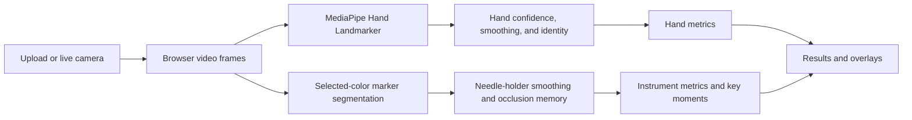

# SurgiSight

SurgiSight is a browser-based computer-vision MVP that turns a recorded surgical practice task into transparent, objective motion measurements for review.

## Why it exists

Surgical practice is often reviewed by watching a recording or relying on subjective impressions. SurgiSight explores a narrower, measurable workflow: capture one standardized practice task, visualize tracked motion, and report clearly defined image-space observations without generating a skill score or medical recommendation.

The current MVP supports one task: **a single simple interrupted suture on a practice pad**.

## Current MVP

- Video upload and live-camera capture
- MediaPipe tracking for up to two hands
- Temporal smoothing, confidence filtering, identity matching, and short occlusion memory
- Completion time
- Separate left- and right-hand path lengths
- Per-hand tracking coverage
- Configurable, marker-assisted needle-holder tracking
- Needle-holder path length and tracking coverage
- Surgical Key Moments: largest instrument excursion and longest instrument pause
- Timestamped replay of key moments for uploaded recordings
- Responsive workflow for laptop and mobile browsers

### Understanding FW units

Path length is reported in **FW**, or **frame-width units**. A distance of `1.0 FW` equals the full width of the video frame. Vertical distances are adjusted for the frame's aspect ratio before being combined with horizontal movement.

FW is a normalized image-space measurement. It makes movement comparable within a recording without pretending that a single, uncalibrated camera can measure centimeters, meters, or true 3D distance.

## Architecture



The application uses:

- Next.js 14 and React 18
- TypeScript
- Tailwind CSS
- MediaPipe Tasks Vision / Hand Landmarker
- Canvas overlays and browser media APIs
- Node's built-in test runner

Tracking and metric code is separated into small modules under `components/`, with deterministic tests under `tests/`.

## Privacy

Video frames and tracking calculations stay in the browser. SurgiSight does not upload recordings to an application server or store analysis results in a database. The browser downloads the MediaPipe runtime and hand model from their configured public hosts when hand tracking loads.

Use practice-pad footage only—never patient footage or identifiable clinical recordings.

## Instrument-tracking disclosure

Needle-holder tracking is currently **marker-assisted**. The user selects a bright marker color and places a matching marker on the instrument. SurgiSight segments that color and tracks the resulting region; it is not true recognition of an unmarked needle holder.

Other objects with the selected color, changing illumination, glare, blur, and occlusion can reduce accuracy or produce a false match.

## Limitations

- This is a portfolio and hackathon MVP, not a medical device or validated assessment system.
- It does not provide clinical guidance, surgical feedback, or skill scoring.
- A single RGB camera cannot recover calibrated physical distance or reliably resolve depth and severe hand overlap.
- Tracking quality depends on framing, lighting, visibility, browser support, and device performance.
- Live-camera sessions show key-moment timestamps but are not recorded for replay; replay is available for uploaded videos.
- Key moments are objective motion events, not judgments about technique or performance.

## Run locally

Prerequisites:

- Node.js 18.18 or newer
- pnpm
- A modern browser with camera support if using live capture

```bash
git clone <repository-url>
cd surgisight
pnpm install
pnpm dev
```

Open [http://localhost:3000](http://localhost:3000).

Camera access works on `localhost`. Approve the browser permission only when you choose **Use Camera**.

## Quality checks

```bash
pnpm test
pnpm lint
pnpm build
```

The focused test commands are also available as `pnpm test:tracking`, `pnpm test:metrics`, and `pnpm test:instrument`.

## Roadmap

1. Unmarked surgical instrument detection
2. Multiple instruments
3. Additional standardized surgical tasks
4. Collection of labeled suturing data
5. Validation against expert-rated surgical performance
